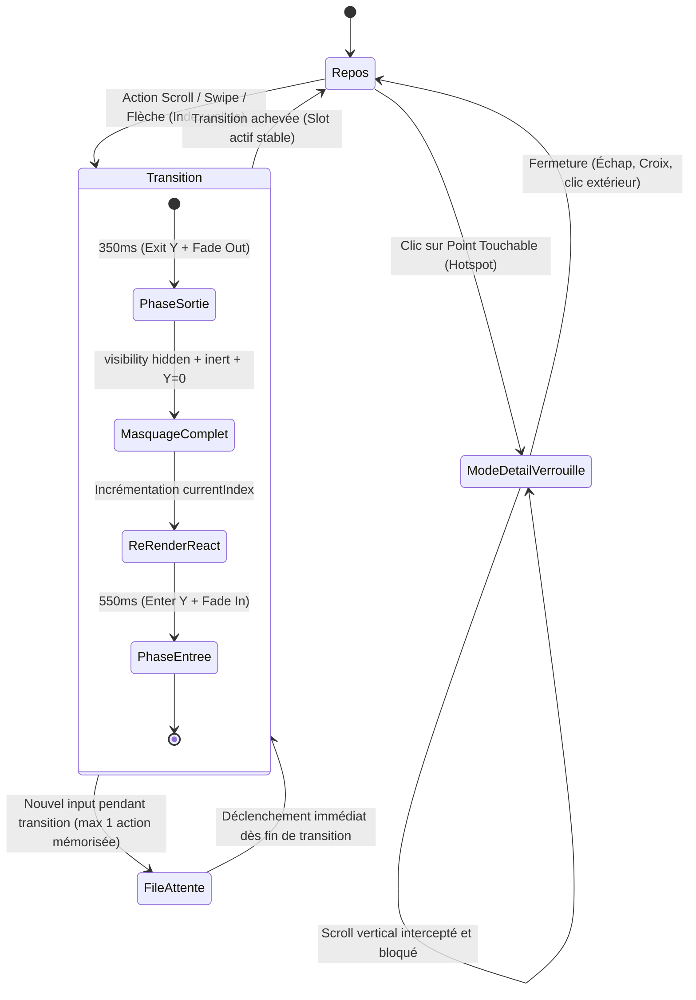

# MISSION_W.md — Rapport Architectural Pré-Développement (V4.4)

> **Document officiel émis par l'Architecte.**  
> Répond exhaustivement aux 17 exigences de la **Section W** du document de référence `prompt_compréhension/V4.2.md` (V4.4).  
> **RÈGLE ABSOLUE : Tout développement reste bloqué tant que ce document n'a pas reçu la validation formelle du propriétaire.**

---

## 1. Maquettes de l'expérience (Clair et Sombre)
* **Bouton de thème** : Positionné de manière fixe en haut à droite (`top: 1.5rem; right: 1.5rem; z-index: 50`). Alternance sobre entre l'icône soleil (en sombre) et lune (en clair), sans flash lumineux ni vibration.
* **Thème Clair (défaut)** :
  * Fond général : `#FAFAF9` (Stone-50, minéral, soyeux, non éblouissant).
  * Surface cartes / panneaux : `#FFFFFF` pur.
  * Typographie primaire : `#1C1917` (Stone-900).
  * Bordures subtiles : `#E7E5E4` (Stone-200).
* **Thème Sombre** :
  * Fond général : `#1C1917` (Stone-900, wengé foncé, pas de noir pur amoled OLED saturé).
  * Surface cartes / panneaux : `#292524` (Stone-800).
  * Typographie primaire : `#F5F5F4` (Stone-100).
  * Bordures subtiles : `#44403C` (Stone-700).
* **Contraste vérifié** : Ratio > 7:1 sur les textes normaux dans les deux modes (supérieur au critère WCAG AAA).

---

## 2. Diagramme d'États du Défilement & Transition GSAP



* **Gestion de fin de collection** : Pas de boucle infinie automatique. Au dernier mannequin, un léger rebond élastique (overscroll de 15px max) indique la fin sans changer d'état.
* **Mode Réduction des animations** : Supprime la translation Y ; transition en simple fondu croisé strict en 150 ms.

---

## 3. Garantie Technique du Mannequin Unique (§B & §D)
* **Garantie structurelle DOM** :
  * Un seul élément conteneur d'image `slotRef` est monté dans l'arbre d'affichage actif.
  * Zéro duplication de composant `<Image />` à l'écran.
* **Garantie temporelle GSAP** :
  * Étape 1 : Le mannequin sortant s'efface totalement (`opacity: 0, duration: 0.35s`).
  * Étape 2 : `slot.style.visibility = "hidden"` et `slot.setAttribute("inert", "")`.
  * Étape 3 : React change la prop de la source d'image `currentIndex`.
  * Étape 4 : Le mannequin entrant apparaît (`opacity: 1, duration: 0.55s`) seulement quand le précédent a physiquement disparu.
* **Test automatisé Playwright (Garde-fou CI)** :
  ```typescript
  test("Garantie stricte : 1 seul mannequin visible pendant toute transition", async ({ page }) => {
    await page.goto("/");
    // Pendant le déclenchement de la transition et les 10 frames intermédiaires :
    const visibleMannequins = await page.locator('[data-slot="mannequin-visuel"]:visible').count();
    expect(visibleMannequins).toBeLessThanOrEqual(1);
  });
  ```

---

## 4. Stratégie Photographique & Flux d'Ajout
* **Normes** : Format d'export WebP / AVIF au ratio vertical **3:4**. Fond studio gris neutre mat (18%) pour s'intégrer harmonieusement sur fond clair ou sombre.
* **Préchargement discret** : Dès qu'une tenue est stabilisée à l'écran, le navigateur utilise `requestIdleCallback` pour précharger l'image de la tenue $N+1$ uniquement.
* **Registre des droits** : Chaque image intégrée dispose d'une fiche validée dans `data/droits-images.json` (photographe, contrat, droits de mannequin). Le build échoue si un ID d'image n'y figure pas.
* **Flux de publication** : Déposer le WebP dans `public/images/tenues/`, renseigner l'entrée dans `droits-images.json`, puis instancier la fiche dans `data/tenues.ts`.

---

## 5. Modèle de Données Catalogue & Extension Pièces Détail (§V)
* **Extension typée dans `src/types/catalogue.ts`** :
  ```typescript
  export interface ZoneTouchable {
    x: number; // en % (0-100)
    y: number; // en % (0-100)
    width: number;
    height: number;
    nomAccessible: string; // Ex: "Voir la veste en détail"
  }

  export interface PieceDetail {
    id: string;
    nom: string;
    type: "vetement" | "accessoire";
    matiere: string;
    description: string;
    zoneTouchable: ZoneTouchable;
    photosMacro: string[]; // Chemins WebP
    rotation360?: {
      dossier: string;
      nombreImages: number; // Ex: 24
    };
    prixXAF?: number; // Optionnel : achat à la pièce
  }
  ```

---

## 6. Animations GSAP & Accessibilité
* **Valeurs normales** :
  * Sortie tenue : `y: -40px` (ou `+40px` si retour), `duration: 0.35s`, `ease: "power2.in"`.
  * Entrée tenue : `y: 60px` vers `0`, `duration: 0.55s`, `ease: "power2.out"`.
  * Montée de la pièce en détail : `scale: 0.9` vers `1.0`, `duration: 0.4s`, `ease: "power3.out"`.
* **Réduction de mouvement (`prefers-reduced-motion`)** :
  * Translations neutralisées (`y: 0`, `scale: 1`).
  * Fondu sec de 150 ms maximum.
  * Pas de rotation continue ou inertielle.

---

## 7. Adaptations Smartphone vs Ordinateur
* **Smartphone (tactile)** :
  * Plein écran vertical (`height: 100dvh` pour neutraliser la barre d'adresse mobile dynamique).
  * Swipe vertical avec seuil minimum de 50px pour éviter les déclenchements parasites.
  * Bouton WhatsApp accessible en zone de pouce basse.
* **Ordinateur (desktop)** :
  * Centrage de la silhouette avec marges confortables.
  * Molette souris limitée (`debounced`) et commandes au clavier (Flèches haut/bas, Espace, Échap).
  * Affichage des métadonnées latérales discrètes sans masquer la tenue.

---

## 8. Parcours de Commande WhatsApp (§M)
1. **Étape 1** : Sélection de la tenue et choix obligatoire de la taille disponible (XS, S, M, L, XL).
2. **Étape 2 (Garde-fou)** : Si la taille est épuisée, le bouton WhatsApp se désactive avec mention « Taille indisponible ». Si aucune taille n'est cochée, un message incite à faire son choix.
3. **Étape 3** : Clic sur « Commander via WhatsApp ». Ouverture de `https://wa.me/242...` avec message prêt à l'envoi :
   > *« Bonjour, je souhaite commander la tenue : Robe Wax Wengé à Motifs Géométriques (Réf : RW-2026-001) en taille M au prix de 45 000 FCFA. »*
4. **Secours** : Affichage clair du numéro de téléphone direct en cas d'absence de l'application WhatsApp.

---

## 9. Catalogue Filtrable & Synchronisation URL (§O)
* **Accès secondaire** : Grille accessible via bouton discret « Explorer le catalogue ».
* **Filtres actifs** :
  * Genre : Femme, Homme, Mixte.
  * Catégorie : Robe, Ensemble, Chemise, Tailleur.
  * Disponibilité : En stock, Pièces limitées.
* **Synchronisation URL** : Chaque état est répercuté dans l'URL (`/catalogue?genre=femme&categorie=robe`), rendant les filtres partageables et indexables.

---

## 10. Arborescence & Pages Institutionnelles (§Q)
* `/` : Défilé immersif principal.
* `/catalogue` : Vue catalogue filtrable en grille sobre.
* `/a-propos` : Histoire de l'atelier, savoir-faire textile à Brazzaville.
* `/guide-tailles` : Tableau des mensurations (statures, tours de poitrine, hanches).
* `/mentions-legales` : Gabarit juridique conforme (raison sociale, hébergeur, propriété intellectuelle).
* `/cgv` : Conditions générales de vente, politique de livraison à Brazzaville et rétractation.
* `/confidentialite` : Déclaration de non-collecte de données personnelles traceuses.

---

## 11. Plan SEO & Données Structurées (§R)
* **Sitemap & Robots** : Génération automatisée via Next.js (`sitemap.ts`, `robots.ts`).
* **Balises canoniques** : URL stricte sur chaque page pour éliminer le contenu dupliqué issu des paramètres de requêtes.
* **JSON-LD Schema.org** :
  * Sur chaque tenue : Type `Product` avec `Offer` (prix en XAF, devise `FCFA`, disponibilité `InStock` ou `OutOfStock`).
  * Racine du site : Type `ClothingStore` localisé à Brazzaville, Congo.

---

## 12. Stratégie de Tests Automatisés & Checklist (§T)
* **Niveau 1 (Unitaire / Zod)** : Validation des schémas de catalogue et de calculs de prix XAF.
* **Niveau 2 (Composants React)** : Tests Vitest sur l'ouverture de l'InfoPanel et du ThemeToggle.
* **Niveau 3 (E2E Playwright)** :
  * Test de non-superposition des mannequins.
  * Test sur viewport mobile 375px et orientation paysage.
  * Test d'accessibilité Axe-core (0 violation critique WCAG AA).
  * Navigation 100% au clavier.

---

## 13. Plan de Déploiement & Hébergement Proposé (§U)
* **Hébergeur recommandé** : **Vercel** relié à la branche principale GitHub.
* **Pipeline CI/CD** : GitHub Actions exécutant :
  1. `npm run lint` & `npm run typecheck`
  2. `npm run test` (Vitest)
  3. `npm run test:e2e` (Playwright)
  4. Blocage strict si des variables `[À COMPLÉTER]` critiques restent en environnement de production.

---

## 14. Maquette de l'Interaction de Détail (§V)
* **Repères visuels (Hotspots)** : Pastilles discrètes semi-transparentes avec pictogramme loupe, sans pulsation agressive.
* **Déclenchement** : Clic ou appui tactile $\rightarrow$ Le mannequin principal passe en opacité réduite (30%), la pièce s'anime au centre de l'écran, le volet de description s'affiche.
* **Visionneuse 360°** :
  * Glissement horizontal tactile ou flèches pour faire défiler les 24 frames de 15°.
  * Boutons de zoom $+ / -$ sans distorsion d'image.
* **Alternative accessible** : Liste ordonnée de boutons sous l'image (« Examiner la tunique », « Examiner le pantalon ») pour les utilisateurs de technologies d'assistance.

---

## 15. Modèle des Pièces et Guide Photos
* Guide rédigé et disponible dans [GUIDE_PHOTOS_DETAIL.md](file:///C:/Users/LENOVO%20T460S%20CORE%20i5/Desktop/Site%20web%20futuriste/GUIDE_PHOTOS_DETAIL.md).
* **Poids cible** : $\le 45$ Ko par frame 360°, ensemble complet de rotation $\le 1,1$ Mo en WebP, chargé de manière progressive uniquement à la demande de l'utilisateur.

---

## 16. Configuration de Marque & Procédure de Renommage (§H & §W.16)
* Fichier pivot unique : [site.config.ts](file:///C:/Users/LENOVO%20T460S%20CORE%20i5/Desktop/Site%20web%20futuriste/site.config.ts).
* Aucun nom n'est codé en dur dans les composants.
* Pour basculer vers le nom officiel :
  1. Modifier `nomCommercial: "NomOfficiel"` dans `site.config.ts`.
  2. Passer `estNomProvisoire: false`.
  3. Remplacer le logo provisoire SVG par le logotype définitif dans `public/logo.svg`.

---

## 17. Risques et Décisions Ouvertes
Détaillés et argumentés dans le registre [DECISIONS.md](file:///C:/Users/LENOVO%20T460S%20CORE%20i5/Desktop/Site%20web%20futuriste/DECISIONS.md) :
1. **Vente à la pièce vs tenue complète** : Recommandation tenue complète par défaut + option à la pièce activable par tenue.
2. **Hébergement** : Vercel recommandé.
3. **Paiement** : 100% WhatsApp + Mobile Money à la livraison (adapté au marché de Brazzaville).
4. **Prix** : Affichage Net TTC en FCFA sans décimales.
